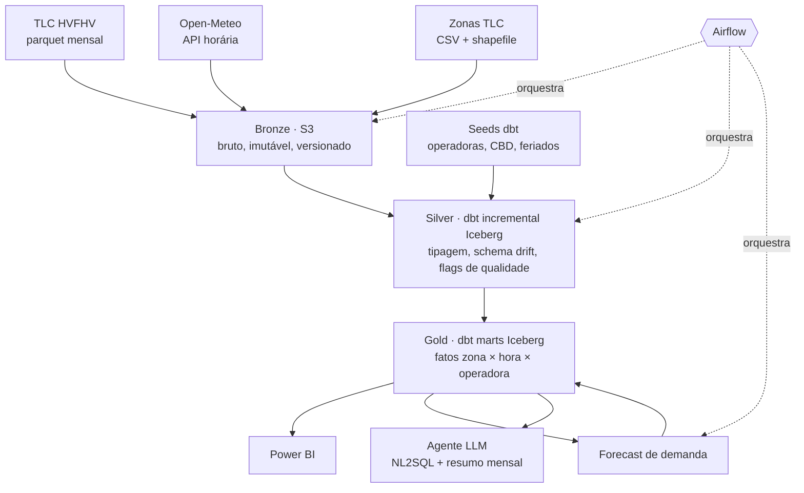

# Especificação do Projeto — Rideshare Marketplace Intelligence (NYC)

> **Versão:** 1.0 · **Data:** 03/10/2026 · **Autor:** Ronald
> **Propósito:** documento-fonte para construir o projeto com o Claude Code. Diz o que construir, por que e em que ordem, e define como o aprendizado deve acontecer em cada etapa.

---

## Sumário

0. Como usar este documento
1. Protocolo de aprendizagem (obrigatório)
2. Visão do projeto
3. Fontes de dados
4. Stack e papel de cada ferramenta
5. Arquitetura
6. Especificação das camadas (Bronze, Silver, Gold)
7. Orquestração (Airflow)
8. Qualidade de dados
9. IA aplicada
10. Power BI
11. Engenharia: repositório, ambientes, CI, IaC, custo e segurança
12. Roadmap por fases
13. Riscos e hipóteses a validar
14. Decisões (ADRs) previstas
- Apêndice A: `CLAUDE.md` sugerido
- Apêndice B: template de aula
- Apêndice C: template do gate de domínio

---

## 0. Como usar este documento

- **Local no repositório:** `docs/PROJECT_SPEC.md`.
- **Para o Claude Code:** antes de qualquer ação, ler a **Seção 1 (Protocolo)** e a **fase atual na Seção 12**. O `CLAUDE.md` da raiz (Apêndice A) carrega as regras essenciais em toda sessão.
- **Legenda de confiança:**
  - ✅ **VERIFICADO (03/10/2026)**: conferido em fonte oficial nesta data.
  - ⚠️ **A VALIDAR**: hipótese ainda não confirmada. Deve ser conferida antes de virar decisão.
- **Mudanças nesta especificação** viram um ADR (registro de decisão de arquitetura) em `docs/adr/` e atualizam este documento. A spec é viva, mas toda mudança precisa ser explícita.

---

## 1. Protocolo de aprendizagem (obrigatório)

### 1.1 Princípio

O projeto tem **dois objetivos de mesmo peso**:

1. Um sistema de dados funcionando, com qualidade de mercado.
2. **Ronald dominar cada tecnologia usada**, sabendo:
   - **o que é**;
   - **para que serve** (que problema resolve);
   - **por que importa para a engenharia de dados**.

> Regra de ouro: código que o Ronald não consegue explicar numa entrevista **não conta como entregue**.

### 1.2 Perfil do aluno

- Analista de BI/dados com experiência sólida em **SQL, Power BI, DAX, Power Query e Microsoft Fabric**.
- Nível intermediário/praticante. **Não infantilizar**: assumir base técnica, mas definir todo conceito novo.
- Aprende melhor com **pontes para o que já conhece**: SQL, Power BI, Fabric e operação de frota/locadora de veículos.
- Idioma: **português do Brasil**.

### 1.3 Regras de linguagem

- **Linguagem simples, frases curtas.** Se der para dizer com menos palavras, diga com menos.
- **Todo termo técnico é definido na primeira vez** que aparece e é adicionado a `docs/glossario.md`.
- **Analogia antes da definição formal.** Primeiro a intuição, depois a precisão.
- Preferir analogias com **SQL, Power BI/Power Query, Fabric e o dia a dia de uma frota**.
- **Se uma explicação não funcionar, trocar de analogia**, por uma mais concreta. Não repetir a mesma ideia com mais palavras.
- **Honestidade técnica:** apontar limitações e críticas legítimas das ferramentas, sem tom promocional. Marcar o que não foi verificado.

### 1.4 Ciclo obrigatório de cada fase

1. **Aula de abertura, antes de qualquer código.** Cada tecnologia ou conceito novo listado na fase (Seção 12) é apresentado no formato do **Apêndice B**.
2. **Plano da fase.** O Claude Code lista os arquivos que vai criar ou alterar, os comandos que vai rodar e os recursos de nuvem afetados, e **espera o OK do Ronald**.
3. **Construção em passos pequenos.**
   - Um arquivo ou conceito por vez.
   - Depois de cada arquivo, explicar: o que faz, por que existe, o que quebraria sem ele e o significado das linhas não óbvias.
   - Nunca gerar vários arquivos de uma vez sem explicação.
4. **"Ronald escreve primeiro" (✍️).** Nas peças marcadas com ✍️ no roadmap:
   - o Ronald escreve a primeira versão;
   - o Claude Code revisa, aponta os erros e explica o porquê;
   - o Claude Code não reescreve tudo de cara. Primeiro dá pistas, depois a correção.
5. **Gate de domínio** (Apêndice C), no fim da fase:
   - o Ronald explica com as próprias palavras;
   - o Claude Code avalia o que está certo, o que está impreciso e o que faltou;
   - **5 perguntas de autoavaliação**, com gabarito no fim;
   - **1 pergunta estilo entrevista**.

   A fase só fecha quando o gate passa.
6. **Registro**, ao fim da fase:
   - `docs/aprendizados/fase-N.md`, com o que aprendeu, os erros cometidos e as decisões tomadas;
   - `docs/glossario.md` atualizado;
   - ADRs novos, se houver.

   Esse material também serve de base para artigos e posts sobre o projeto.

### 1.5 Regras de segurança e execução

- **Parar e pedir confirmação explícita** antes de qualquer uma destas ações, **listando o que será alterado e o custo estimado**:
  - `terraform apply` e `terraform destroy`;
  - criar qualquer recurso pago;
  - apagar ou sobrescrever dados no S3 ou em tabelas;
  - `git push --force`;
  - qualquer comando irreversível.
- **Nunca commitar credenciais.** Usar perfil da AWS CLI ou variáveis de ambiente. O `.env` fica no `.gitignore`.
- **Ler o estado atual** de arquivo, tabela ou schema antes de alterar qualquer coisa existente.
- **Divergência entre esta spec e a realidade** (um dado diferente do esperado, uma documentação que mudou): parar, explicar e propor o ajuste via ADR. Nunca contornar em silêncio.
- **Quando houver mais de uma opção técnica razoável:** apresentar os trade-offs e uma recomendação, e deixar o Ronald decidir.

### 1.6 Ponte Fabric → nova stack

> São **analogias de partida**, não equivalências exatas. Na aula de cada fase, explicar também **onde a analogia quebra**.

| O que o Ronald já conhece (Fabric/Power BI) | Equivalente aproximado neste projeto | Onde a analogia quebra |
|---|---|---|
| OneLake / Files do Lakehouse | Bucket **S3** | O S3 não tem catálogo nem "tabela" por si só; é só armazenamento de arquivos |
| Tabelas Delta do Lakehouse | Tabelas **Apache Iceberg** no **Glue Data Catalog** | Formatos diferentes, mesma ideia: arquivos + metadados formando uma tabela |
| SQL analytics endpoint | **Amazon Athena** | O Athena cobra por dados lidos, não por capacidade reservada |
| Data Pipeline / Copy activity | **DAG do Airflow** com tasks em Python | O Airflow é código e pode orquestrar qualquer coisa, não só o ecossistema Microsoft |
| Notebooks / Dataflow Gen2 transformando dados | **Modelos dbt** em SQL | O dbt não move dados: ele só gera e roda SQL dentro do warehouse |
| Capacidade F2/F64 (CU) | Cobrança por **TB lido** no Athena + armazenamento no S3 | Custo variável por consulta, sem capacidade fixa para pausar |
| Itens criados manualmente no workspace | Recursos declarados no **Terraform** | A infraestrutura vira código versionado e reproduzível |
| Relacionamentos no modelo semântico | **`ref()`** e testes de relacionamento no dbt | No dbt a dependência é entre transformações, não entre tabelas do modelo |

### 1.7 Banco de analogias inicial

Pontos de partida para as aulas. O Claude Code pode e deve criar outras melhores.

| Conceito | Analogia |
|---|---|
| **S3 (armazenamento de objetos)** | Um galpão infinito de caixas etiquetadas: você guarda e busca pela etiqueta (a chave), mas não "edita" uma caixa por dentro, só troca a caixa inteira |
| **Parquet (formato colunar)** | Uma planilha guardada por coluna, não por linha. Para somar a coluna "tarifa", você lê só essa coluna e ignora o resto, como no motor VertiPaq do Power BI |
| **Particionamento** | Arquivo morto com uma pasta por mês: para achar março, você abre só a pasta de março |
| **Apache Iceberg (formato de tabela)** | O sumário de um livro que diz quais arquivos formam a tabela "agora", o que permite voltar a versões anteriores e mudar colunas sem reescrever tudo |
| **Athena** | Rodar SQL direto sobre arquivos, sem servidor ligado. É um táxi: você paga pela distância percorrida (dados lidos), não pelo carro parado |
| **dbt** | Power Query escrito em SQL, com versionamento, testes e documentação. Cada modelo é uma receita, e o `ref()` diz qual receita depende de qual |
| **Airflow** | Gerente de produção com cronograma: sabe a ordem das tarefas, quem depende de quem, tenta de novo quando algo falha e registra tudo |
| **DAG** | Um fluxograma de tarefas sem voltas: a manutenção preventiva só começa depois que o veículo chega ao pátio |
| **Idempotência** | Apertar o botão do elevador duas vezes não chama dois elevadores. Rodar o mesmo processamento duas vezes dá o mesmo resultado |
| **Backfill** | Reprocessar os meses passados como se o pipeline já existisse naquela época |
| **Terraform** | A planta da casa: o `plan` é o orçamento ("vou construir isso"), o `apply` é a obra, e o arquivo de estado é o registro do que já foi construído |
| **Docker** | Um contêiner de navio: o ambiente vai inteiro e lacrado, e funciona igual em qualquer porto (máquina) |
| **Medallion (Bronze/Silver/Gold)** | Recebimento → inspeção e limpeza → produto pronto na prateleira. Equivale às etapas de um veículo chegando à frota: entra como veio, passa por vistoria e padronização, e só então fica disponível para locação |
| **Modelo incremental** | Atualizar só as páginas novas do relatório mensal, em vez de reimprimir o livro inteiro |

---

## 2. Visão do projeto

### 2.1 Resumo

Sistema de **inteligência de marketplace** para uma operadora de ride-hailing (transporte por aplicativo) em Nova York, construído sobre os dados públicos de corridas da **TLC (Taxi & Limousine Commission)**.

O fluxo é este:

1. O Airflow detecta cada novo arquivo mensal publicado.
2. O dbt transforma os dados em camadas Bronze → Silver → Gold no lakehouse da AWS.
3. A camada Gold alimenta três consumidores:
   - um **Power BI** de equilíbrio entre oferta e demanda e de economia unitária;
   - uma **previsão de demanda** por zona e hora;
   - um **agente de IA** que responde perguntas em linguagem natural e gera um resumo mensal.

### 2.2 O que o projeto deve demonstrar (objetivo de portfólio)

- **Visão de negócio:** perguntas de decisão claras e métricas com definição documentada.
- **Engenharia de dados de mercado:**
  - ingestão recorrente real;
  - idempotência e reprocessamento;
  - schema drift (mudança de schema ao longo do tempo);
  - particionamento;
  - testes e controle de custo.
- **Stack neutra de fornecedor:** AWS, formatos abertos (Parquet, Iceberg) e ferramentas open source (dbt, Airflow).
- **IA pragmática:** cada uso tem métrica de sucesso e um baseline a vencer. Resultado negativo é reportado com honestidade.

### 2.3 Persona e contexto

- **Persona:** time de Marketplace da **Lyft** em Nova York.
- **Benchmark competitivo:** Uber. As duas operadoras aparecem identificadas no dado pelo código de licença (⚠️ A VALIDAR: HV0003 = Uber, HV0005 = Lyft, conferir no dicionário oficial).

### 2.4 Perguntas de negócio (o que o projeto responde)

1. **Onde e quando falta oferta?**
   - **Sinal:** tempo de espera P90 alto por zona e hora.
   - **Ação:** reposicionar motoristas ou ativar incentivos.
2. **Como evolui a economia unitária?**
   - **Métricas:** take rate, receita por milha e por minuto, repasse por hora de corrida.
3. **Qual foi o impacto da taxa de congestionamento de Manhattan** (Congestion Relief Zone, em vigor desde jan/2025)?
   - **Comparação:** antes e depois, em volume, tarifa e destino das corridas que entram no centro (CBD).
   - Funciona como experimento natural.
4. **Qual é o share da Lyft versus a Uber por zona**, e onde estamos perdendo terreno?

### 2.5 Definições de métricas (contrato)

> Estas definições são a **fonte única da verdade**. As medidas DAX do Power BI e o contexto do agente de IA devem usar exatamente estas fórmulas. Ficam documentadas no YAML do dbt (`meta`).

| Métrica | Definição | Cuidado (pegadinha) |
|---|---|---|
| **Corridas válidas** | Contagem de corridas com `is_valid = true` | Inválidas ficam na Silver com o motivo, mas não entram na Gold |
| **Tempo de espera (s)** | `pickup_datetime − request_datetime` | **Não usar `on_scene_datetime`**: só é preenchido para veículos acessíveis (✅ VERIFICADO no dicionário oficial) |
| **Espera P50 / P90** | Percentis do tempo de espera | **Percentil não soma nem tira média entre zonas.** Por isso a Gold guarda um histograma de faixas de espera (ver 6.4) |
| **Take rate** | `(base_passenger_fare − driver_pay) / base_passenger_fare` | `driver_pay` exclui pedágios e gorjetas e é líquido de comissão, sobretaxas e impostos (✅ VERIFICADO). Impostos e taxas são repassados e ficam fora |
| **Receita por milha** | `base_passenger_fare / trip_miles` | Excluir `trip_miles = 0` (já marcado como inválido na Silver) |
| **Repasse por hora de corrida** | `driver_pay / (trip_time / 3600)` | **Não é o ganho por hora do motorista**: o dado não tem tempo ocioso nem identificador de motorista |
| **Share da operadora** | Corridas da operadora / corridas totais (mesmo recorte) | Calcular sobre o mesmo recorte de zona e período |
| **Corrida com destino no CBD** | `DOLocationID` dentro da lista de zonas do CBD (seed) | **Não usar `cbd_congestion_fee > 0`** para comparar antes e depois: a coluna só existe a partir de 2025 (✅ VERIFICADO) |

### 2.6 Fora do escopo da v1

- Táxis amarelos e verdes e FHV não-HV (candidatos à v2).
- Streaming ou tempo real.
- Análise por motorista ou veículo: o dado **não tem identificador de motorista nem de veículo**.
- Atualização agendada do Power BI no Service, se exigir gateway (ver riscos).

---

## 3. Fontes de dados

### 3.1 TLC — High Volume For-Hire Vehicle (HVFHV)

| Item | Valor |
|---|---|
| **Página oficial** | https://www.nyc.gov/site/tlc/about/tlc-trip-record-data.page |
| **Padrão de URL** | `https://d37ci6vzurychx.cloudfront.net/trip-data/fhvhv_tripdata_YYYY-MM.parquet` |
| **Dicionário** | https://www.nyc.gov/assets/tlc/downloads/pdf/data_dictionary_trip_records_hvfhs.pdf |
| **Cadência** | Mensal, normalmente com **~2 meses de atraso** e sem data fixa de publicação (✅ VERIFICADO) |
| **Último mês disponível em 03/10/2026** | ago/2026 (✅ VERIFICADO) |
| **Republicação** | A TLC já republicou arquivos antigos (seção "Errata" da página) → **a ingestão precisa detectar arquivos alterados** (✅ VERIFICADO) |
| **Schema drift** | `cbd_congestion_fee` adicionada a partir de 2025. A TLC também avisa sobre possíveis padronizações de schema (✅ VERIFICADO) |
| **Volume** | ⚠️ A VALIDAR na Fase 1: estimativa de dezenas de milhões de linhas e centenas de MB por mês |

**Colunas esperadas** (⚠️ A VALIDAR contra o arquivo real na Fase 1):

- **Identificação:** `hvfhs_license_num`, `dispatching_base_num`, `originating_base_num`
- **Tempo:** `request_datetime`, `on_scene_datetime`, `pickup_datetime`, `dropoff_datetime`
- **Local:** `PULocationID`, `DOLocationID`
- **Corrida:** `trip_miles`, `trip_time`
- **Valores:** `base_passenger_fare`, `tolls`, `bcf`, `sales_tax`, `congestion_surcharge`, `airport_fee`, `tips`, `driver_pay`, `cbd_congestion_fee`
- **Flags:** `shared_request_flag`, `shared_match_flag`, `access_a_ride_flag`, `wav_request_flag`, `wav_match_flag`

**Limitações conhecidas:**

- Não há chave única de corrida.
- Não há identificador de motorista ou veículo.
- O tempo de espera depende de `request_datetime`.

### 3.2 Zonas da TLC

- **Tabela de zonas (CSV):** `https://d37ci6vzurychx.cloudfront.net/misc/taxi_zone_lookup.csv`
- **Shapefile:** `https://d37ci6vzurychx.cloudfront.net/misc/taxi_zones.zip`. Será convertido para TopoJSON para o mapa do Power BI.

### 3.3 Clima: Open-Meteo (API histórica)

- Dados horários de um ponto representativo (Central Park, aprox. 40.78, −73.97).
- Variáveis candidatas: temperatura, precipitação, neve, vento.
- ⚠️ A VALIDAR: endpoint, nomes das variáveis, limites de uso e licença.
- **Simplificação assumida:** um único ponto para toda a cidade. Documentar como limitação.

### 3.4 Seeds do dbt (dados estáticos versionados)

| Seed | Conteúdo |
|---|---|
| `seed_operadoras.csv` | Código da licença → nome da operadora |
| `seed_zonas_cbd.csv` | LocationIDs dentro da Congestion Relief Zone (⚠️ A VALIDAR: montar a partir da definição oficial da MTA, Manhattan ao sul da rua 60) |
| `seed_feriados_us.csv` | Feriados federais e de NY no período |

### 3.5 Recorte temporal

- **De jan/2024 até o último mês publicado:** 12 meses antes da taxa de congestionamento e o restante depois.
- O pipeline continua incorporando os meses novos automaticamente.

---

## 4. Stack e papel de cada ferramenta

> Cada ferramenta tem um papel que **não poderia ser cumprido de forma mais simples**. Se em algum momento isso deixar de ser verdade, registrar num ADR.

| Ferramenta | Papel no projeto | Por que esta | Alternativa considerada |
|---|---|---|---|
| **AWS S3** | Armazenamento das três camadas | Padrão de mercado para data lake; barato | GCS, ADLS |
| **Apache Iceberg** | Formato de tabela da Silver e da Gold | Aberto; transações ACID; evolução de schema; overwrite por partição | Delta Lake |
| **AWS Glue Data Catalog** | Catálogo de metadados (onde ficam as tabelas) | Integração nativa com o Athena | Hive Metastore |
| **Amazon Athena** | Motor SQL serverless (warehouse) | Sem servidor ligado; paga por dado lido | BigQuery (plano B), Databricks Free Edition (descartado: cotas diárias e internet restrita) |
| **dbt Core + dbt-athena** | Transformações SQL versionadas e testadas | Padrão de mercado para analytics engineering | SQL solto, Spark |
| **Apache Airflow (Astro CLI, local)** | Orquestração: ingestão, dbt, ML | Ingestão mensal real dá papel legítimo a ele | MWAA (caro demais para portfólio) |
| **Astronomer Cosmos** | Transformar modelos dbt em tasks do Airflow | Visibilidade e retry por modelo | BashOperator rodando `dbt build` |
| **Terraform** | Infraestrutura como código | Reproduzível e revisável | Console da AWS (manual) |
| **Docker** | Rodar o Airflow localmente | Ambiente idêntico em qualquer máquina | Instalação local |
| **Python** | Ingestão, ML e agente de IA | Padrão em engenharia de dados | — |
| **Power BI** | Visualização para o negócio | Domínio existente do Ronald; mercado | Superset, Looker Studio |
| **API de LLM** (ex.: Claude) | Agente NL2SQL e resumo mensal | Uso com métrica de avaliação | — |
| **GitHub Actions** | CI: testes de dbt, validação do Terraform | Grátis para repositório público | — |

⚠️ A VALIDAR na Fase 0: versão do Airflow (2.x ou 3.x) do runtime atual do Astro. No Airflow 3, "Datasets" passou a se chamar "Assets". Confirmar também a compatibilidade com o Cosmos.

---

## 5. Arquitetura



**Mapeamento Medallion × convenção dbt:**

| Camada Medallion | Onde fica | Convenção de nomes |
|---|---|---|
| Bronze | Arquivos brutos no S3 + tabelas externas no Glue | — |
| Silver | Modelos dbt | `stg_*` (limpeza 1:1 com a fonte) e `int_*` (lógica intermediária) |
| Gold | Modelos dbt | `fct_*`, `dim_*`, `ml_*` (prontos para consumo) |

---

## 6. Especificação das camadas

### 6.1 Convenções

- **Bancos no Glue:**
  - `bronze`, `silver`, `gold` (produção);
  - `dev_bronze`, `dev_silver`, `dev_gold` (desenvolvimento).
- **Buckets:** `s3://<prefixo>-lake/{bronze,silver,gold}/` e um bucket separado para os resultados do Athena.
- **Nomes:** `snake_case`. Tabelas e colunas em português na Gold (consumo do negócio). Na Bronze e na Silver de staging, manter os nomes originais da fonte, convertidos para minúsculas.
- **Datas e horas:** guardar em UTC ou no horário local de NY, de forma explícita. ⚠️ A VALIDAR: em que fuso a TLC publica os horários (provavelmente horário local de NY). Documentar em ADR.

### 6.2 Bronze

**Objetivo:** guardar a fonte **exatamente como chegou**, com rastreabilidade total.

- **Layout:** `bronze/tlc_hvfhv/year=YYYY/month=MM/ingest_ts=YYYYMMDDTHHMMSS/fhvhv_tripdata_YYYY-MM.parquet`
- **Imutável:** nunca sobrescrever. Quando a TLC republica um mês, grava-se uma **nova versão** (novo `ingest_ts`).
- **Manifesto de ingestão** (tabela `bronze.ingestion_manifest`, Iceberg):

| Coluna | Descrição |
|---|---|
| `source` | `tlc_hvfhv`, `open_meteo`, `tlc_zones` |
| `source_month` | Mês de referência (YYYY-MM) |
| `source_url` | URL baixada |
| `etag`, `last_modified` | Cabeçalhos HTTP usados para detectar republicação |
| `file_sha256` | Hash do arquivo |
| `row_count` | Linhas no arquivo |
| `schema_hash` | Hash da lista de colunas e tipos (detecta schema drift) |
| `s3_path` | Caminho gravado |
| `ingest_ts` | Momento da ingestão |
| `is_current` | Se esta é a versão vigente do mês |

- **Tabela externa** no Glue sobre os arquivos, particionada por `year`, `month` e `ingest_ts`.
  - Avaliar **partition projection** no Athena para não precisar registrar partições manualmente. É conceito da Fase 2.
- **Validação de schema na ingestão:** comparar com o schema esperado (contrato).
  - Coluna nova ou faltante: registrar no manifesto e alertar.
  - Tipo diferente: parar e decidir via ADR.

### 6.3 Silver

**Objetivo:** dado confiável, tipado e padronizado, **sem perder nada**.

| Modelo | Descrição |
|---|---|
| `stg_tlc__hvfhv_trips` | Lê **apenas a versão vigente** de cada mês (join com o manifesto); tipa, renomeia e trata o schema drift (`cbd_congestion_fee` nula antes de 2025) |
| `stg_tlc__zones` | Zonas tipadas |
| `stg_open_meteo__weather_hourly` | Clima horário |
| `int_trips_enriched` | Colunas derivadas e flags de qualidade |

**Colunas derivadas em `int_trips_enriched`:**

| Coluna | Cálculo |
|---|---|
| `wait_time_s` | `pickup_datetime − request_datetime`, em segundos |
| `speed_mph` | `trip_miles / (trip_time / 3600)` |
| `take_rate` | Ver 2.5 |
| `is_dropoff_cbd` | Destino na lista do seed de CBD |
| `pickup_hour` | Hora truncada do embarque |
| `source_month` | Mês do arquivo de origem |

**Regras obrigatórias:**

1. **Chave surrogate.** Não existe chave natural de corrida. Gerar um hash (ex.: `dbt_utils.generate_surrogate_key`) a partir de licença, horários, zonas e valores.
   - Testar a unicidade.
   - Documentar em ADR a política para duplicatas exatas.
2. **Qualidade se marca, não se apaga.** Colunas `is_valid` e `invalid_reason`. Regras iniciais (⚠️ calibrar com os dados reais):
   - tarifa base ≤ 0;
   - `trip_time` ≤ 0;
   - `trip_miles` ≤ 0;
   - `speed_mph` > 100;
   - `wait_time_s` < 0 ou acima de um teto definido;
   - zona inexistente.
3. **Incremental idempotente por partição.**
   - A tabela Iceberg é particionada por **`source_month`**, e não pelo mês do embarque, porque corridas na virada do mês e dados ruins podem cair fora do mês do arquivo.
   - Estratégia: `insert_overwrite` (ou `merge`) por partição. Reprocessar um mês substitui só aquele mês.
   - ⚠️ A VALIDAR: quais estratégias incrementais o dbt-athena suporta para Iceberg na versão instalada.

### 6.4 Gold

**Objetivo:** tabelas pequenas, com grão claro, prontas para o Power BI, o ML e o agente de IA. **A corrida individual não sai da Silver.**

| Modelo | Grão (uma linha por...) | Conteúdo principal |
|---|---|---|
| `dim_zona` | zona | borough, nome, `service_zone`, `is_cbd`, `is_aeroporto` |
| `dim_operadora` | operadora | código da licença, nome |
| `dim_tempo_hora` | hora | data, hora, dia da semana, fim de semana, feriado, variáveis de clima |
| `fct_demanda_zona_hora` | hora × zona de origem × operadora | corridas, milhas, segundos de corrida, tarifa base, repasse, gorjetas, taxa CBD, corridas com destino no CBD, corridas compartilhadas |
| `fct_espera_histograma` | hora × zona × operadora × faixa de espera | corridas por faixa (ex.: 0–2, 2–4, 4–6, 6–10, 10–15, 15+ min). Permite **calcular percentis aproximados em qualquer nível de agregação** |
| `fct_od_diario` | dia × zona de origem × zona de destino × operadora | corridas, tarifa base, milhas |
| `ml_forecast_demanda` | hora-alvo × zona × execução | previsão, intervalo, versão do modelo |
| `ml_backtest_metricas` | execução × janela | WAPE do modelo e do baseline |

- **Testes de integridade:** toda `fct_*` tem testes de relacionamento com as `dim_*` e de não-nulos nas chaves.
- **Definições das métricas:** ficam no YAML (`meta`) dos modelos. São a fonte para as medidas DAX e para o contexto do agente.

---

## 7. Orquestração (Airflow)

As DAGs são encadeadas por **dependência de dados** (Datasets/Assets), e não por horários soltos.

| DAG | Gatilho | O que faz |
|---|---|---|
| `tlc_ingest` | Diário | Verifica se o **próximo mês esperado** existe (HTTP HEAD). Se existir, baixa para a Bronze, valida o schema, grava o manifesto e publica o Asset `bronze_tlc`. Também verifica o **ETag dos últimos 3 meses** para detectar republicação |
| `weather_ingest` | Asset `bronze_tlc` ou mensal | Busca o clima do período novo na API e grava na Bronze |
| `dbt_build` | Assets da Bronze | Roda via **Cosmos**: `dbt source freshness`, depois os modelos e os testes da Silver, o **gate de qualidade** (Seção 8) e por fim a Gold. Se o gate falhar, a Gold não é atualizada |
| `ml_forecast` | Asset `gold_demanda` | Treino, backtest, previsão e gravação em `ml_*` |
| `llm_monthly_summary` | Após `ml_forecast` | Calcula os deltas do mês em SQL e gera a narrativa (ver 9.3) |

**Requisitos de toda DAG:**

- **Idempotente:** rodar duas vezes o mesmo mês gera o mesmo resultado.
- **Backfill possível:** consegue processar jan/2024 até hoje.
- **Retries** com espera crescente nas tasks de rede.
- **Sem segredos no código.** Credenciais vêm via Connections ou variáveis de ambiente.
- **Logs claros**, com o mês processado e a contagem de linhas.

---

## 8. Qualidade de dados

| Camada | Testes |
|---|---|
| **Fonte** | `dbt source freshness` com limite de aviso de ~75 dias (coerente com o atraso de publicação). ⚠️ Calibrar |
| **Silver** | `unique` e `not_null` na chave surrogate; `accepted_values` em flags e licenças; `relationships` com as zonas; percentual de inválidas por mês abaixo de um limite |
| **Gate de volume** | Teste singular: as linhas válidas do mês ficam dentro de uma faixa esperada (ex.: ±25% da média dos 3 meses anteriores, ajustado por sazonalidade). Fora da faixa → falha → quarentena e alerta |
| **Gold** | Integridade com as dimensões; soma das corridas na Gold igual às válidas da Silver (reconciliação) |

---

## 9. IA aplicada

> Princípio: **cada uso de IA tem uma métrica de sucesso e um baseline.** Se não vencer o baseline, isso é reportado. Resultado honesto vale mais do que IA decorativa.

### 9.1 Previsão de demanda (ML)

- **Alvo:** corridas por zona e hora (todas as operadoras), para o mês seguinte ao último disponível.
- **Escopo inicial:** as top N zonas por volume (ex.: 50). ⚠️ Definir N com os dados.
- **Baseline obrigatório:** sazonal ingênuo, a média da mesma hora e dia da semana nas últimas 4 semanas.
- **Modelo candidato:** gradient boosting (ex.: LightGBM), global para todas as zonas.
- **Features:**
  - defasagens (lags) de 1 a 4 semanas;
  - hora, dia da semana, feriado;
  - clima.
- **Avaliação:**
  - backtest walk-forward mensal nos últimos 6 meses;
  - métrica **WAPE** (erro percentual ponderado, robusto a zeros).
- **Pegadinhas a ensinar:**
  - **Vazamento de dados:** em produção o clima seria previsão, não observação. Documentar.
  - **Atraso de 2 meses:** a previsão não é operacional. O enquadramento honesto é "validado em backtest; em produção seria alimentado por streaming".
- **Execução:** Python numa task do Airflow, lendo a Gold via AWS SDK for pandas (awswrangler) e gravando em `gold.ml_*`.

### 9.2 Detecção de anomalias

1. **Regras na Silver:** `is_valid` / `invalid_reason`. É a primeira linha de defesa.
2. **Volume por mês:** o gate da Seção 8.
3. **Estatística robusta** (z-score pela mediana/MAD) sobre volume e receita por milha por zona e mês. Só para o que as regras não pegam.
   - Modelos mais complexos (ex.: Isolation Forest) **só se** as regras e a estatística se mostrarem insuficientes, com justificativa em ADR.

### 9.3 LLM

**a) Agente NL2SQL sobre a Gold**

- **Entrada:** pergunta em português.
- **Contexto do modelo:**
  - schema da Gold;
  - definições das métricas (YAML do dbt);
  - exemplos de perguntas com o SQL correspondente.
- **Guardrails (barreiras de segurança):**
  - workgroup do Athena exclusivo, com limite de bytes por consulta;
  - acesso **somente leitura e somente ao banco `gold`**;
  - validação do SQL antes de rodar (parser, ex.: sqlglot): só `SELECT`, com `LIMIT`.
- **Saída:** a resposta, o número e **o SQL usado**, para dar transparência.
- **Avaliação:** um conjunto de 20 a 30 **perguntas-ouro** com a resposta esperada. Métrica: percentual de acerto na execução. Rodar a cada mudança de prompt ou modelo.
- **Interface:** CLI ou Streamlit simples. ⚠️ Decidir na Fase 6.

**b) Resumo mensal automático**

- **Regra inviolável:** **o LLM nunca calcula números.**
  - Os deltas (variações mês a mês e ano a ano, top zonas que subiram ou caíram, take rate) são calculados em SQL.
  - O LLM recebe só esses números e escreve a narrativa.
- **Saída:** um Markdown versionado em `docs/resumos/` ou no S3.
- **Avaliação:** checagem automática de que todo número citado no texto existe na entrada.

---

## 10. Power BI

- **Conexão:** conector nativo do Amazon Athena (via driver ODBC), em modo **Import** sobre a Gold.
- **Modelo:** estrela, com `fct_*` ligadas a `dim_zona`, `dim_operadora` e `dim_tempo_hora`.
- **Medidas DAX** seguem a Seção 2.5. O P50 e o P90 vêm de `fct_espera_histograma`, por interpolação entre as faixas.

**Páginas:**

1. **Visão executiva:** KPIs principais e tendência.
2. **Oferta × demanda:** mapa de zonas com a espera P90 por hora e dia da semana.
3. **Economia unitária:** take rate, receita por milha, repasse por hora de corrida.
4. **Taxa de congestionamento:** antes e depois, CBD versus não-CBD (com comparação de tendências).
5. **Forecast × realizado:** com o WAPE do modelo e do baseline.

**Publicação:** ⚠️ A VALIDAR se a atualização no Service exige gateway. Plano B: o `.pbix` no repositório, com prints e um vídeo curto no README.

---

## 11. Engenharia: repositório, ambientes, CI, IaC, custo e segurança

### 11.1 Estrutura do repositório

```
rideshare-marketplace-intelligence/
├── CLAUDE.md                  # regras essenciais para o Claude Code (Apêndice A)
├── README.md                  # vitrine do projeto (problema, arquitetura, resultados)
├── docs/
│   ├── PROJECT_SPEC.md        # este documento
│   ├── glossario.md
│   ├── adr/                   # 0001-escolha-aws.md, ...
│   ├── aprendizados/          # fase-0.md, fase-1.md, ...
│   └── resumos/               # saídas do resumo mensal
├── infra/terraform/           # S3, Glue, workgroups do Athena, IAM, budget
├── airflow/                   # projeto Astro (dags/, include/, requirements.txt)
├── dbt/                       # models/staging, intermediate, marts; seeds; tests; macros
├── ml/                        # treino, backtest, previsão
├── llm/                       # agente NL2SQL, resumo mensal, perguntas-ouro
├── powerbi/                   # .pbix, TopoJSON das zonas, prints
└── .github/workflows/         # CI
```

### 11.2 Ambientes

- **dev:** bancos `dev_*`. Usa uma amostra de 1 a 2 meses.
- **prod:** bancos sem prefixo. Período completo.
- **Troca de ambiente:** via `target` do dbt e variáveis do Airflow.

### 11.3 CI (GitHub Actions)

- `terraform fmt -check` e `terraform validate`.
- `dbt build` em **slim CI** (só modelos alterados, com `state:modified` e `--defer`) contra o dev.
- Lint de SQL (ex.: sqlfluff) e de Python (ex.: ruff).

### 11.4 Custo

- **AWS Budget** com alerta de US$ 10/mês, criado **antes** de qualquer outro recurso.
- **Workgroups do Athena** com limite de bytes por consulta.
- Particionamento e modelos incrementais para que cada execução leia só o mês necessário.
- ⚠️ A VALIDAR: preços atuais do Athena e do S3 em us-east-1.

### 11.5 Segurança

- IAM com **menor privilégio**: um usuário ou role para o Airflow e outro, somente leitura, para o Power BI e o agente.
- Root com MFA e nunca usado no dia a dia.
- Buckets privados, com bloqueio de acesso público.
- Segredos fora do Git.

### 11.6 Git

- Conventional Commits (`feat:`, `fix:`, `docs:`, `chore:`...).
- Uma branch por fase, com PR revisado (o Claude Code pode revisar).
- Repositório público desde o início.

---

## 12. Roadmap por fases

> Toda fase segue o ciclo da **Seção 1.4**: aula, plano, construção em passos pequenos, ✍️, gate e registro.
> A estratégia é a **fatia vertical primeiro**: um mês percorrendo tudo antes de escalar. Assim os maiores riscos técnicos são testados cedo.

### Fase 0: Fundação

- **Objetivo:** ambiente reproduzível e seguro, com custo controlado.
- **Conceitos a dominar (aula):**
  - Git e GitHub (fluxo de branches e PR);
  - AWS: contas, regiões, IAM (usuários, roles, políticas, menor privilégio), AWS CLI e perfis;
  - S3 (armazenamento de objetos, buckets, chaves);
  - Glue Data Catalog (o que é um catálogo de metadados);
  - Athena (motor serverless, cobrança por dado lido, workgroups);
  - Terraform (provider, recurso, estado, `plan` × `apply`, por que IaC);
  - Docker (imagem × contêiner);
  - arquitetura do Airflow (scheduler, webserver/API, executor, banco de metadados) e Astro CLI.
- **Entregas:**
  - repositório criado;
  - `CLAUDE.md`;
  - Terraform com budget, buckets, bancos no Glue, workgroups e IAM;
  - Airflow rodando localmente;
  - ADR 0001 (escolha da AWS).
- **✍️ Ronald escreve:** o primeiro recurso Terraform (bucket S3) e a política IAM do Airflow.
- **Pronto quando:**
  - `terraform plan` está limpo depois do apply;
  - a UI do Airflow abre;
  - uma consulta `SELECT 1` funciona no Athena pelo workgroup;
  - o alerta de budget está ativo.

### Fase 1: Fatia vertical (1 mês, ponta a ponta)

- **Objetivo:** validar os três maiores riscos:
  - tamanho e custo por mês;
  - modelo incremental do dbt-athena com Iceberg;
  - Power BI conectado ao Athena.
- **Conceitos a dominar:**
  - Parquet e armazenamento colunar;
  - particionamento estilo Hive;
  - tabela externa × tabela gerenciada;
  - Apache Iceberg (snapshots, evolução de schema, time travel);
  - dbt (projeto, `profiles.yml`, sources, models, `ref()`, materializações view/table/incremental, seeds, `dbt build`);
  - adaptador dbt-athena;
  - driver ODBC e conector do Athena no Power BI.
- **Entregas:**
  - download manual de 1 mês para a Bronze;
  - tabela externa;
  - `stg_tlc__hvfhv_trips` mínimo;
  - `fct_demanda_zona_hora` mínimo;
  - 1 visual no Power BI;
  - **relatório de validação** com o tamanho real, as linhas, o custo das consultas e as colunas reais comparadas com as esperadas (atualizar a Seção 3).
- **✍️ Ronald escreve:** o primeiro modelo dbt de staging e o primeiro `fct`.
- **Pronto quando:** os três riscos estão respondidos, com evidência, e as hipóteses ⚠️ da Seção 3 foram atualizadas.

### Fase 2: Bronze completa e ingestão automatizada

- **Objetivo:** ingestão real, idempotente e com detecção de republicação.
- **Conceitos a dominar:**
  - DAG, task, operator, sensor;
  - agendamento, `catchup` e backfill;
  - Datasets/Assets (dependência por dados);
  - retries;
  - idempotência;
  - HTTP HEAD, ETag e Last-Modified;
  - manifesto de ingestão e linhagem;
  - contrato de schema e schema drift;
  - partition projection no Athena.
- **Entregas:**
  - DAGs `tlc_ingest` e `weather_ingest`;
  - manifesto;
  - validação de schema;
  - backfill de jan/2024 até hoje;
  - ADRs de Bronze imutável e de fuso horário.
- **✍️ Ronald escreve:** a função que decide "baixar, ignorar ou reprocessar" com base no manifesto.
- **Pronto quando:**
  - rodar a DAG duas vezes não duplica nada;
  - uma republicação simulada (ETag alterado) gera uma nova versão e marca `is_current`.

### Fase 3: Silver e Gold

- **Objetivo:** modelos completos, testados e com o gate de qualidade.
- **Conceitos a dominar:**
  - camadas staging, intermediate e marts;
  - modelagem dimensional (Kimball: fato, dimensão, **grão**);
  - chave surrogate;
  - estratégias incrementais (`insert_overwrite` × `merge`) e idempotência por partição;
  - testes genéricos e singulares;
  - `source freshness`;
  - documentação e `meta` no YAML;
  - macros e Jinja (o básico);
  - Cosmos;
  - por que percentil não é aditivo, e a solução com histograma.
- **Entregas:**
  - todos os modelos da Seção 6;
  - testes da Seção 8;
  - DAG `dbt_build` com o gate;
  - `dbt docs`;
  - ADRs de chave surrogate, partição por `source_month`, percentis via histograma e CBD por zona.
- **✍️ Ronald escreve:** as regras de `is_valid` e o teste singular do gate de volume.
- **Pronto quando:**
  - a reconciliação entre Silver e Gold bate;
  - o gate barra um mês adulterado de propósito.

### Fase 4: Power BI

- **Objetivo:** responder às 4 perguntas de negócio da Seção 2.4.
- **Conceitos a dominar (foco no que é novo para o Ronald):**
  - conectar a um warehouse externo;
  - Import × DirectQuery com cobrança por dado lido;
  - **consistência semântica** (a métrica definida no dbt e reproduzida no DAX);
  - percentil a partir de histograma em DAX;
  - mapa com TopoJSON;
  - gateway.
- **Entregas:** as 5 páginas da Seção 10, as medidas DAX documentadas, prints e o vídeo curto.
- **✍️ Ronald escreve:** todas as medidas DAX (é a sua área de domínio; o Claude Code revisa).
- **Pronto quando:** cada pergunta de negócio tem uma resposta visível e um insight escrito.

### Fase 5: Previsão de demanda (ML)

- **Objetivo:** um modelo que vença o baseline, ou um relatório honesto de que não venceu.
- **Conceitos a dominar:**
  - séries temporais (tendência, sazonalidade);
  - baseline ingênuo e por que ele vem primeiro;
  - features de defasagem (lag) e calendário;
  - vazamento de dados;
  - backtest walk-forward;
  - WAPE × MAPE;
  - gradient boosting (intuição);
  - versionamento de modelo.
- **Entregas:** o código em `ml/`, a DAG `ml_forecast`, as tabelas `ml_*` e a página 5 do Power BI.
- **✍️ Ronald escreve:** o baseline ingênuo e o cálculo do WAPE.
- **Pronto quando:** o backtest roda de forma reprodutível e o resultado (positivo ou não) está documentado.

### Fase 6: LLM

- **Objetivo:** um agente NL2SQL avaliado e o resumo mensal confiável.
- **Conceitos a dominar:**
  - como um LLM é chamado por API (mensagens, tokens, custo);
  - prompt com contexto estruturado;
  - NL2SQL e por que ele erra;
  - guardrails;
  - conjunto de avaliação (perguntas-ouro);
  - alucinação numérica e a regra "LLM não calcula".
- **Entregas:**
  - o agente em `llm/`;
  - as perguntas-ouro com o script de avaliação;
  - a DAG `llm_monthly_summary`.
- **✍️ Ronald escreve:** as 20 a 30 perguntas-ouro com as respostas esperadas (exige entender o negócio).
- **Pronto quando:**
  - a acurácia nas perguntas-ouro está medida e registrada;
  - o resumo passa na checagem de números.

### Fase 7: Acabamento de portfólio

- **Objetivo:** o projeto se explica sozinho para um recrutador em 2 minutos.
- **Conceitos a dominar:**
  - CI/CD;
  - slim CI do dbt (`state:modified`, `--defer`);
  - lint;
  - ADR como prática;
  - como escrever um README técnico de portfólio.
- **Entregas:**
  - CI completo;
  - README com o problema, a arquitetura, as decisões, os resultados, as limitações e o "como rodar";
  - os ADRs revisados.
- **✍️ Ronald escreve:** o README (o Claude Code revisa a clareza).
- **Pronto quando:** uma pessoa de fora consegue entender o problema, a solução e os resultados lendo só o README.

---

## 13. Riscos e hipóteses a validar

| # | Risco ou hipótese | Fase | Mitigação |
|---|---|---|---|
| R1 | Volume e custo mensal maiores que o estimado | 1 | Medir na fatia vertical; reduzir o recorte se necessário |
| R2 | O dbt-athena não suportar a estratégia incremental desejada com Iceberg | 1 | Testar cedo; alternativa `merge`, ou overwrite de partição via macro |
| R3 | O Power BI exigir gateway para atualizar no Service | 1/4 | Plano B: `.pbix` + prints + vídeo |
| R4 | Tipos de coluna diferentes entre arquivos da TLC | 1/2 | Contrato de schema na ingestão + ADR |
| R5 | Fuso horário dos timestamps | 2 | Confirmar no guia oficial da TLC; ADR |
| R6 | Códigos de licença das operadoras | 1 | Conferir no dicionário oficial |
| R7 | Lista de zonas do CBD | 3 | Montar a partir da definição oficial da MTA; documentar a fonte |
| R8 | Versão do Airflow (2.x × 3.x) e compatibilidade com o Cosmos | 0 | Fixar versões no `requirements.txt` |
| R9 | Endpoint, limites e licença do Open-Meteo | 2 | Conferir a documentação oficial |
| R10 | O forecast não vencer o baseline | 5 | Reportar com honestidade; isso também é resultado |

---

## 14. Decisões (ADRs) previstas

| ADR | Decisão | Status |
|---|---|---|
| 0001 | AWS (S3 + Glue + Athena) como plataforma | Decidido |
| 0002 | Iceberg como formato de tabela da Silver e da Gold | Decidido |
| 0003 | Bronze imutável e versionada por `ingest_ts` | Decidido |
| 0004 | Chave surrogate por hash e política de duplicatas | A decidir (Fase 3) |
| 0005 | Partição da Silver por `source_month` | Decidido (validar na Fase 1) |
| 0006 | Percentis de espera via histograma na Gold | Decidido (validar na Fase 3) |
| 0007 | CBD definido por lista de zonas, e não pela taxa | Decidido |
| 0008 | Airflow local (Astro) em vez de serviço gerenciado | Decidido |
| 0009 | Fuso horário padrão | A decidir (Fase 2) |
| 0010 | Interface do agente (CLI × Streamlit) | A decidir (Fase 6) |
| 0011 | PBIP (Power BI Project, em texto) no lugar do `.pbix` | A decidir (Fase 4) |
| 0012 | Estado do Terraform no S3, com versionamento e trava nativa | Decidido |

**Formato de ADR:** Contexto → Decisão → Alternativas consideradas → Consequências (o que ganhamos e o que perdemos).

---

## Apêndice A: `CLAUDE.md` sugerido

> Copie o conteúdo abaixo (sem as cercas de código) para `CLAUDE.md` na raiz do repositório.
> - O Claude Code carrega o `CLAUDE.md` automaticamente em toda sessão.
> - Ele aceita importar outros arquivos com `@caminho/arquivo`, mas importar esta spec inteira gastaria contexto em toda sessão. Por isso o `CLAUDE.md` traz só as regras essenciais e manda ler a spec sob demanda.

```markdown
# Rideshare Marketplace Intelligence — instruções para o Claude Code

## Contexto
Projeto de portfólio de engenharia de dados (AWS S3 + Glue + Athena/Iceberg, dbt, Airflow, Power BI, IA).
Especificação completa: docs/PROJECT_SPEC.md. Antes de cada fase, leia a Seção 1 e a fase atual na Seção 12.
Fase atual: 0  ← atualizar ao avançar

## Objetivo duplo (inegociável)
1. Construir o sistema com qualidade de mercado.
2. Garantir que o Ronald DOMINE cada tecnologia: o que é, para que serve, por que importa na engenharia de dados.
Código que ele não consegue explicar não conta como entregue.

## Como ensinar
- Português do Brasil. Linguagem simples, frases curtas, sem infantilizar.
- Analogia antes da definição formal. Preferir pontes com SQL, Power BI/Power Query, Microsoft Fabric e operação de frota.
- Definir todo termo técnico na primeira vez e adicioná-lo a docs/glossario.md.
- Se a explicação não funcionar, trocar de analogia, não repetir a mesma.
- Aula de cada tecnologia nova no formato do Apêndice B da spec, ANTES de escrever código.

## Como construir
- Antes de escrever código: apresentar o plano (arquivos, comandos, recursos de nuvem) e esperar OK.
- Um arquivo/conceito por vez. Depois de cada arquivo: o que faz, por que existe, o que quebra sem ele.
- Peças marcadas ✍️ na spec: o Ronald escreve primeiro; você revisa, dá pistas antes da correção.
- No fim da fase: gate de domínio (Apêndice C da spec). A fase só fecha quando o gate passa.
- Ao fechar a fase: docs/aprendizados/fase-N.md, glossário e ADRs atualizados.

## Segurança (sempre)
- PARE e peça confirmação explícita, listando o que muda e o custo estimado, antes de: terraform apply/destroy,
  criar recurso pago, apagar/sobrescrever dados no S3 ou em tabelas, git push --force, qualquer ação irreversível.
- Nunca commitar credenciais. Ler o estado atual antes de alterar algo existente.
- Divergência entre a spec e a realidade: parar, explicar, propor ADR. Nunca contornar em silêncio.
- Marcar como "não verificado" tudo que não foi conferido em fonte oficial.
```

---

## Apêndice B: template de aula (para cada tecnologia ou conceito novo)

```markdown
## [Nome da tecnologia/conceito]

**Núcleo — o que é:** 1 a 2 frases, sem jargão (ou com o jargão definido).

**Para que serve — o problema que resolve:** que dor existia antes dela? O que acontece sem ela?

**Intuição — analogia:** de preferência com SQL, Power BI, Fabric ou frota. Dizer também onde a analogia quebra.

**Por que importa na engenharia de dados:** papel no mercado, quando se usa e quando NÃO se usa.

**Exemplo concreto neste projeto:** onde aparece no repositório, com um trecho real de código ou comando.

**Onde se encaixa + pegadinha:** como se conecta às outras peças, e o erro clássico de iniciante ou o comportamento contraintuitivo.

**Comparação com o que o Ronald já conhece:** equivalente no Fabric/Power BI, se houver.
```

---

## Apêndice C: template do gate de domínio (fim de cada fase)

```markdown
# Gate de domínio — Fase N

## 1. Explicação com as próprias palavras (Ronald)
Para cada tecnologia da fase: o que é, para que serve, por que foi usada AQUI e não outra coisa.

## 2. Avaliação (Claude Code)
- Correto: ...
- Impreciso (e a correção): ...
- Faltou: ...

## 3. Autoavaliação: 5 perguntas
Misturar: 2 conceituais, 2 aplicadas ao projeto ("o que acontece se..."), 1 de diagnóstico de erro.
(Gabarito só no final do documento, depois de o Ronald responder.)

## 4. Pergunta estilo entrevista
Ex.: "Como você garante que reprocessar um mês não duplica dados?"
Resposta-modelo em até 1 minuto de fala, para treino.

## 5. Resultado
[ ] Passou: a fase pode fechar.
[ ] Revisar: listar os tópicos e repetir a aula com outra analogia.

## Gabarito
...
```
