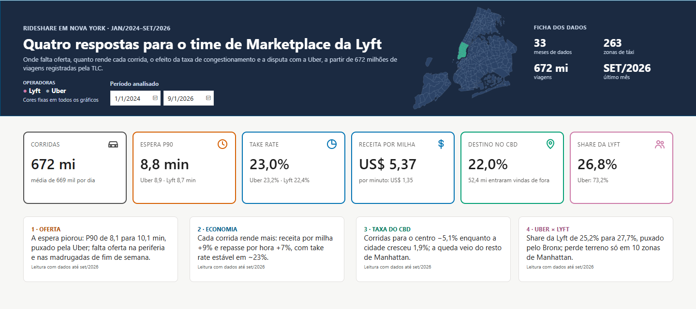
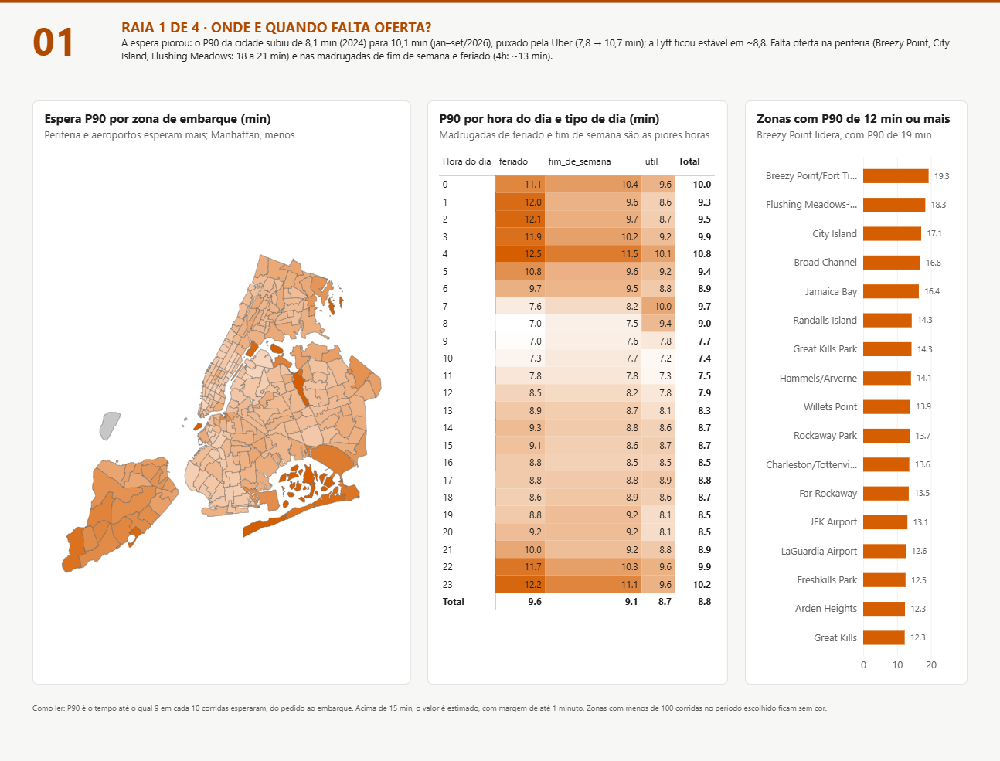
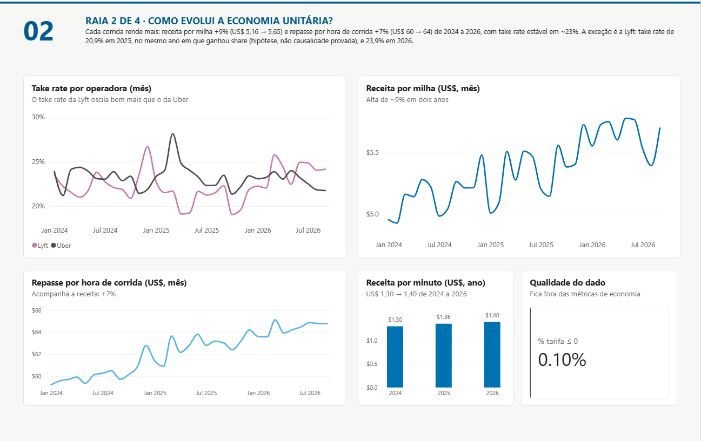
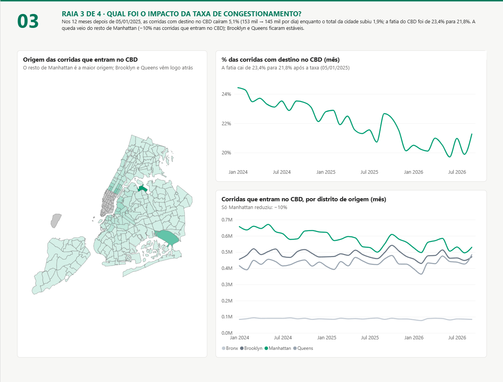
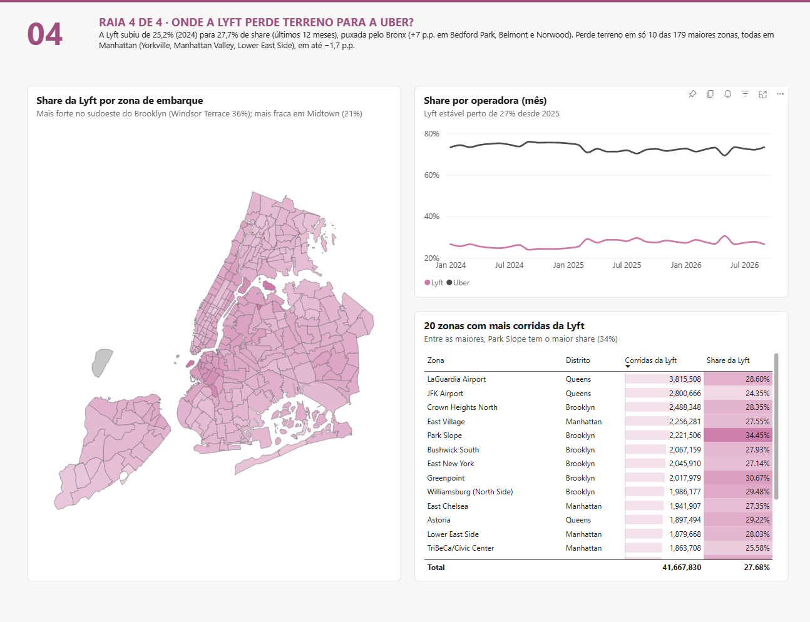
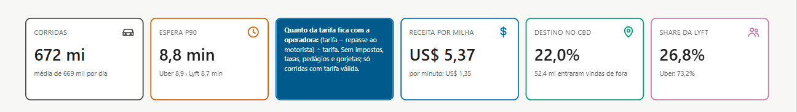

# Relatório: quatro respostas para o time de Marketplace da Lyft

Uma página única, de rolagem vertical, que responde às quatro perguntas de negócio do projeto com dados de **672 milhões de viagens** de Uber e Lyft em Nova York (jan/2024–set/2026), vindos da camada Gold do lakehouse na AWS.

**Vídeo (40 s), rolando o relatório no Power BI Service:**

https://github.com/user-attachments/assets/57491ecf-722b-4c4d-a495-e67a7a7986be

## O que o relatório responde

| # | Pergunta | Resposta (dados até set/2026) |
|---|---|---|
| 1 | Onde e quando falta oferta? | A espera piorou: o P90 da cidade subiu de 8,1 min (2024) para 10,1 min (jan–set/2026), puxado pela Uber. Falta oferta na periferia (Breezy Point, City Island, Flushing Meadows) e nas madrugadas de fim de semana e feriado |
| 2 | Como evolui a economia unitária? | Cada corrida rende mais: receita por milha +9% e repasse por hora de corrida +7%, com take rate estável em ~23% |
| 3 | Qual foi o impacto da taxa de congestionamento? | Nos 12 meses depois de 05/01/2025, as corridas para o centro caíram 5,1% enquanto a cidade cresceu 1,9%; a queda veio do resto de Manhattan |
| 4 | Onde a Lyft perde terreno para a Uber? | A Lyft subiu de 25,2% para 27,7% de share, puxada pelo Bronx; perde terreno só em 10 zonas de Manhattan |

| Raia | Imagem |
|---|---|
| 1 · Oferta |  |
| 2 · Economia |  |
| 3 · Taxa do CBD |  |
| 4 · Uber × Lyft |  |

Ao passar o mouse sobre um cartão, ele mostra o que é o número e como é calculado:

## Como foi construído

| Peça | Escolha | Por quê |
|---|---|---|
| Fonte | Camada **Gold** (Apache Iceberg no S3, consultada pelo Athena), em modo **Import** | Consulta paga por dado lido: importar uma vez é mais barato e rápido que consultar a cada clique |
| Modelo | **Estrela** com 3 fatos (demanda por hora, histograma de espera, origem-destino mensal) e dimensões de tempo encadeadas (mês → período → hora) | Um filtro de mês chega às três fatos pelo caminho certo, inclusive ao histograma, que não tem hora real |
| Métricas | Fórmulas definidas uma vez no dbt e reproduzidas no DAX (take rate como razão das somas, economia só com tarifa válida) | **Consistência semântica**: o mesmo número no SQL e no Power BI |
| Espera P90 | Calculada a partir de um **histograma de faixas** guardado na Gold, por interpolação | Percentil não soma nem tira média; o histograma permite recalcular o P90 para qualquer recorte. Conferido contra o Athena em 9 recortes |
| Página | **Página única com raias**, uma por pergunta, com resposta escrita antes dos gráficos | Leitura de apresentação executiva ([ADR 0019](../docs/adr/0019-relatorio-pagina-unica-com-raias.md)) |
| Versionamento | **PBIP** (modelo em TMDL, relatório em PBIR), em texto no Git | Diferenças linha a linha e revisão das medidas ([ADR 0011](../docs/adr/0011-pbip-no-repositorio.md)) |
| Página como código | Os visuais foram gerados por um script a partir de um contrato de desenho ([`gerador/gerar_pagina.js`](gerador/gerar_pagina.js), [`_brief/report-spec.md`](../_brief/report-spec.md)) e refinados no Desktop | Reprodutível e revisável |
| Mapa | TopoJSON próprio das 263 zonas de táxi, gerado do shapefile oficial ([`mapas/`](mapas/README.md)) | Os mapas padrão não conhecem as zonas da TLC |

## Como abrir

O projeto abre no **Power BI Desktop** pelo arquivo `rideshare-marketplace/Rideshare Marketplace Intelligence.pbip`. Os dados importados (`cache.abf`, ~540 MB) não ficam no Git: para ver números, é preciso atualizar a partir do Athena, o que exige acesso à conta AWS do projeto, o driver ODBC do Amazon Athena (2.5) e o DSN `rideshare-athena`. Sem esse acesso, o modelo e as medidas podem ser lidos como texto em `Rideshare Marketplace Intelligence.SemanticModel/definition/`.

## Limitações conhecidas

- A espera P90 acima de 15 minutos é estimada (margem de até 1 minuto), por causa da largura das faixas do histograma.
- As respostas escritas são leituras fixas com dados até set/2026; cartões e gráficos seguem o período escolhido.
- A versão publicada no Power BI Service é uma foto dos dados, sem atualização agendada (exigiria um gateway local).
- O formato dos números nos gráficos segue a configuração regional de quem vê o relatório (nos prints, inglês: `3,815,508`, `Jan 2024`), mesmo com o modelo em `pt-BR`. Cartões, título, ficha e respostas formatam em português por conta própria.
